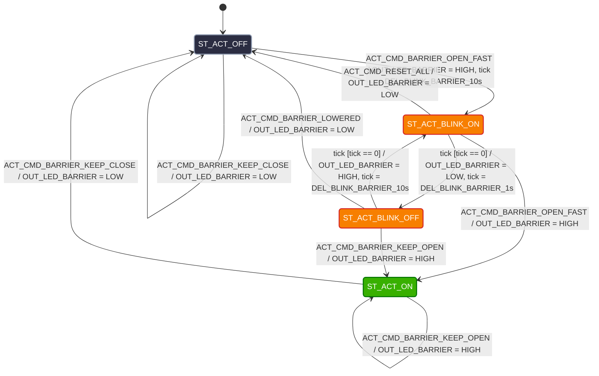

# Actuator Layer: State Machine & Timers

## 1. Módulo Actuator

El módulo **Actuator** es el encargado de comandar las salidas digitales de la placa prototipo (LEDs y comunicación UART) según las órdenes recibidas de la capa `System`. 

Garantiza la independencia del hardware mediante máquinas de estado locales que gestionan tiempos de encendido, apagado y frecuencias de destello (parpadeos) sin bloquear la ejecución del bucle principal de $1\text{ms}$.

---

## 2. Salidas Digitales Mapeadas

* `OUT_LED_PRINT` (LED Azul): Indicador de impresión y emisión de ticket.
* `OUT_LED_BARRIER` (LED Verde): Indicador del estado y movimiento de la barrera vehicular.
* `OUT_LED_SERVER` / `UART_TX` (LED Rojo / Serie): Indicador de transmisión/recepción de datos con el servidor central.

---

## 3. Definición de Variables y Comandos del Módulo

### Comandos Recibidos de `System`
* `ACT_CMD_PRINT_START`: Enciende el indicador de impresión.
* `ACT_CMD_BARRIER_OPEN_FAST`: Inicia parpadeo rápido ($5\text{Hz}$, $T = 2\text{s}$) para indicar barrera subiendo.
* `ACT_CMD_BARRIER_KEEP_OPEN`: Enciende en forma continua el LED de barrera (barrera levantada).
* `ACT_CMD_BARRIER_CLOSE_SLOW`: Inicia parpadeo lento ($1\text{Hz}$, $T = 10\text{s}$) para indicar barrera bajando.
* `ACT_CMD_BARRIER_LOWERED`: Apaga el LED de la barrera (barrera completamente cerrada).
* `ACT_CMD_SERVER_LOG_PATENT`: Genera un destello corto ($10\text{s}$) para indicar envío de datos de patente al servidor.
* `ACT_CMD_RESET_ALL`: Fuerza el apagado de todas las salidas y resetea las FSM de la capa Actuator.
* `ACT_CMD_BARRIER_KEEP_CLOSE`: Apaga en forma continua el LED de barrera (barrera baja).

### Estados Internos de Parpadeo
* `ST_ACT_OFF`: Salida forzada a nivel bajo ($0\text{V}$).
* `ST_ACT_ON`: Salida forzada a nivel alto ($3.3\text{V}$).
* `ST_ACT_BLINK_ON`: Indicador de la barrera en subida o bajada.
* `ST_ACT_BLINK_OFF`: Indicador de la barrera en subida o bajada.

### Temporizadores del Sistema
* `DEL_BLINK_BARRIER`: Contador para controlar el medio período de destello del LED de barrera.
* `DEL_COMM_PULSE`: Contador para el pulso de transmisión del LED de servidor.
* `tick`: Evento de reloj del sistema (1ms) utilizado para decrementar los temporizadores.

---
## 4. Diagrama de Transición de Estados (Actuator FSM)

## 5. Tabla de Transición de Estados (STT) - Control de Barrera (`OUT_LED_BARRIER`)

| Estado Actual | Evento / Comando Recibido | Condición [Guardia] | Estado Siguiente | Acciones Realizadas |
| :--- | :--- | :--- | :--- | :--- |
| `ST_ACT_OFF` | `ACT_CMD_BARRIER_OPEN_FAST` | - | `ST_ACT_BLINK_ON` | `OUT_LED_BARRIER = HIGH`, `tick = DEL_BLINK_BARRIER_10s` |
| `ST_ACT_OFF` | `ACT_CMD_BARRIER_KEEP_CLOSE` | - | `ST_ACT_OFF` | `OUT_LED_BARRIER = LOW` |
| `ST_ACT_OFF` | `tick` | `[tick > 0]` | `ST_ACT_OFF` | `tick--` |
| `ST_ACT_OFF` | `tick` | `[tick == 0]` | `ST_ACT_OFF` | - |
| `ST_ACT_ON` | `ACT_CMD_BARRIER_KEEP_OPEN` | - | `ST_ACT_ON` | `OUT_LED_BARRIER = HIGH` |
| `ST_ACT_ON` | `ACT_CMD_BARRIER_KEEP_CLOSE` | - | `ST_ACT_OFF` | `OUT_LED_BARRIER = LOW` |
| `ST_ACT_ON` | `tick` | `[tick > 0]` | `ST_ACT_ON` | `tick--` |
| `ST_ACT_ON` | `tick` | `[tick == 0]` | `ST_ACT_ON` | - |
| `ST_ACT_BLINK_ON` | `tick` | `[tick > 0]` | `ST_ACT_BLINK_ON` | `tick--` |
| `ST_ACT_BLINK_ON` | `tick` | `[tick == 0]` | `ST_ACT_BLINK_OFF` | `OUT_LED_BARRIER = LOW`, `tick = DEL_BLINK_BARRIER_1s` |
| `ST_ACT_BLINK_ON` | `ACT_CMD_BARRIER_OPEN_FAST` | - | `ST_ACT_ON` | `OUT_LED_BARRIER = HIGH` |
| `ST_ACT_BLINK_ON` | `ACT_CMD_RESET_ALL` | - | `ST_ACT_OFF` | `OUT_LED_BARRIER = LOW` |
| `ST_ACT_BLINK_OFF` | `tick` | `[tick > 0]` | `ST_ACT_BLINK_OFF` | `tick--` |
| `ST_ACT_BLINK_OFF` | `tick` | `[tick == 0]` | `ST_ACT_BLINK_ON` | `OUT_LED_BARRIER = HIGH`, `tick = DEL_BLINK_BARRIER_10s` |
| `ST_ACT_BLINK_OFF` | `ACT_CMD_BARRIER_LOWERED` | - | `ST_ACT_OFF` | `OUT_LED_BARRIER = LOW` |
| `ST_ACT_BLINK_OFF` | `ACT_CMD_BARRIER_KEEP_OPEN` | - | `ST_ACT_ON` | `OUT_LED_BARRIER = HIGH` |
---

## 6. Tabla de Transición de Estados (STT) - Impresora y Servidor

### 6.1. Indicador de Impresión (`OUT_LED_PRINT`)
| Estado Actual | Comando Recibido | Condición | Estado Siguiente | Acciones Realizadas |
| :--- | :--- | :--- | :--- | :--- |
| `ST_ACT_OFF` | `ACT_CMD_PRINT_START` | - | `ST_ACT_ON` | `OUT_LED_PRINT = HIGH` |
| `ST_ACT_ON` | `ACT_CMD_RESET_ALL` | - | `ST_ACT_OFF` | `OUT_LED_PRINT = LOW` |

### 6.2. Indicador de Comunicación Servidor (`OUT_LED_SERVER`)
| Estado Actual | Evento / Comando | Condición [Guardia] | Estado Siguiente | Acciones Realizadas |
| :--- | :--- | :--- | :--- | :--- |
| `ST_ACT_OFF` | `ACT_CMD_SERVER_LOG_PATENT` | - | `ST_ACT_ON` | `OUT_LED_SERVER = HIGH`, `tick=DEL_COMM_PULSE_10s` |
| `ST_ACT_OFF` | - | - | `ST_ACT_OFF` | `ACT_CMD_RESET_ALL` |
| `ST_ACT_ON` | `tick` | `[tick > 0]` | `ST_ACT_ON` | `tick--` |
| `ST_ACT_ON` | `tick` | `[tick == 0]` | `ST_ACT_OFF` | `OUT_LED_SERVER = LOW` |
