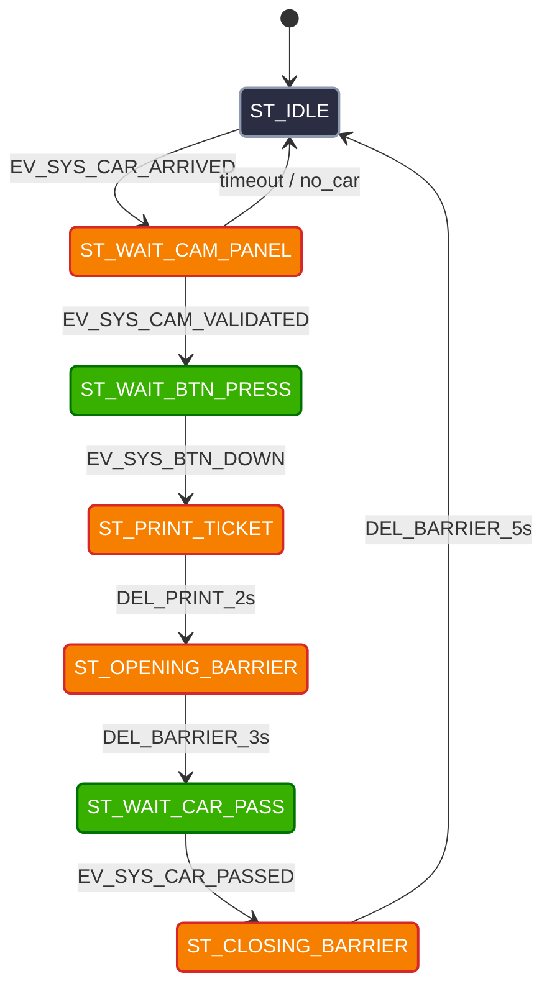

# System Layer: FSM & Main Logic

## 1. Módulo System

El módulo **System** es el núcleo del firmware. Implementa la Máquina de Estados Finitos (FSM) principal encargada de procesar las señales recibidas de la capa `Sensor`, coordinar los tiempos de espera y enviar comandos de control a la capa `Actuator`.

---
### Estados 
* `ST_IDLE`: Estado de reposo. El sistema espera a que un vehículo se estacione sobre la bobina.
* `ST_WAIT_CAM_PANEL`: Espera a que la cámara registre y valide la patente del vehículo detectado.
* `ST_WAIT_BTN_PRESS`: Espera a que el usuario presione el botón para solicitar su ticket.
* `ST_PRINT_TICKET`: Simula el tiempo de impresión/emisión del ticket.
* `ST_OPENING_BARRIER`: Barrera subiendo (LED titilando a alta frecuencia, 5Hz).
* `ST_WAIT_CAR_PASS`: Barrera completamente abierta; espera a que el auto cruce y libere la bobina.
* `ST_CLOSING_BARRIER`: Barrera bajando (LED titilando a baja frecuencia, 1Hz).

### Eventos / Señales Entrantes
* `EV_SYS_CAR_ARRIVED`: Notificación de la capa `Sensor` de presencia/ocupación de vehículo en la bobina.
* `EV_SYS_CAM_VALIDATED`: Notificación de lectura y validación correcta de la patente.
* `EV_SYS_BTN_DOWN`: Notificación de pulsación del botón de ticket.
* `EV_SYS_CAR_PASSED`: Notificación de la capa `Sensor` de desocupación/liberación de la bobina.

### Comandos Hacia la Capa Actuator
* `ACT_CMD_CAM_CAPTURE`: Activa el modo de espera/captura de la cámara.
* `ACT_CMD_SERVER_LOG_PATENT`: Envía la información de la patente al servidor central vía UART.
* `ACT_CMD_PRINT_START`: Enciende el indicador de impresión (LED 1 en ON).
* `ACT_CMD_BARRIER_OPEN_FAST`: Configura el LED 2 en parpadeo rápido (5Hz, barrera subiendo).
* `ACT_CMD_BARRIER_KEEP_OPEN`: Mantiene el LED 2 encendido continuo (barrera alta).
* `ACT_CMD_BARRIER_CLOSE_SLOW`: Configura el LED 2 en parpadeo lento (1Hz, barrera bajando).
* `ACT_CMD_BARRIER_LOWERED`: Apaga el LED 2 (barrera cerrada).
* `ACT_CMD_RESET_ALL`: Apaga todas las salidas y restablece el estado de reposo.

### Temporizadores del Sistema
* `DEL_TIMEOUT_10s`: Tiempo límite de espera para validación de cámara (10000ms).
* `DEL_TIMEOUT_15s`: Tiempo límite de espera para pulsación de botón (15000ms).
* `DEL_TIMEOUT_20s`: Tiempo límite de espera para que el auto libere la bobina (20000ms).
* `DEL_PRINT_2s`: Tiempo simulado de emisión/impresión del ticket (2000ms).
* `DEL_BARRIER_3s`: Tiempo de apertura/subida de la barrera (3000ms).
* `DEL_BARRIER_5s`: Tiempo de cierre/bajada de la barrera (5000ms).
* `tick`: Evento de reloj del sistema (1ms) utilizado para decrementar los temporizadores.

## 2. Diagrama de Estados FSM Principal (`System`)

## Tabla de Transición de Estados (System STT)

| Estado Actual | Evento / Signal Recibido | Condición [Guardia] | Estado Siguiente | Acciones Realizadas / Comandos a `Actuator` |
| :--- | :--- | :--- | :--- | :--- |
| `ST_IDLE` | `EV_SYS_CAR_ARRIVED` | - | `ST_WAIT_CAM_PANEL` | `ACT_CMD_CAM_CAPTURE`, `tick = DEL_TIMEOUT_10s` |
| `ST_IDLE` | `EV_SYS_CAR_PASSED` | - | - | - |
| `ST_WAIT_CAM_PANEL` | `EV_SYS_CAM_VALIDATED` | - | `ST_WAIT_BTN_PRESS` | `ACT_CMD_SERVER_LOG_PATENT`, `tick = DEL_TIMEOUT_15s` |
| `ST_WAIT_CAM_PANEL` | `tick` | `[tick > 0]` | `ST_WAIT_CAM_PANEL` | `tick--` |
| `ST_WAIT_CAM_PANEL` | `tick` | `[tick == 0]` | `ST_IDLE` | `ACT_CMD_RESET_ALL` |
| `ST_WAIT_CAM_PANEL` | `EV_SYS_CAR_PASSED` | - | `ST_IDLE` | `ACT_CMD_RESET_ALL` |
| `ST_WAIT_BTN_PRESS` | `EV_SYS_BTN_DOWN` | - | `ST_PRINT_TICKET` | `ACT_CMD_PRINT_START`, `tick = DEL_PRINT_2s` |
| `ST_WAIT_BTN_PRESS` | `tick` | `[tick > 0]` | `ST_WAIT_BTN_PRESS` | `tick--` |
| `ST_WAIT_BTN_PRESS` | `tick` | `[tick == 0]` | `ST_IDLE` | `ACT_CMD_RESET_ALL` |
| `ST_WAIT_BTN_PRESS` | `EV_SYS_CAR_PASSED` | - | `ST_IDLE` | `ACT_CMD_RESET_ALL` |
| `ST_PRINT_TICKET` | `tick` | `[tick > 0]` | `ST_PRINT_TICKET` | `tick--` |
| `ST_PRINT_TICKET` | `tick` | `[tick == 0]` | `ST_OPENING_BARRIER` | `ACT_CMD_BARRIER_OPEN_FAST`, `tick = DEL_BARRIER_3s` |
| `ST_OPENING_BARRIER` | `tick` | `[tick > 0]` | `ST_OPENING_BARRIER` | `tick--` |
| `ST_OPENING_BARRIER` | `tick` | `[tick == 0]` | `ST_WAIT_CAR_PASS` | `ACT_CMD_BARRIER_KEEP_OPEN`, `tick = DEL_TIMEOUT_20s` |
| `ST_WAIT_CAR_PASS` | `EV_SYS_CAR_PASSED` | - | `ST_CLOSING_BARRIER` | `ACT_CMD_BARRIER_CLOSE_SLOW`, `tick = DEL_BARRIER_5s` |
| `ST_WAIT_CAR_PASS` | `tick` | `[tick > 0]` | `ST_WAIT_CAR_PASS` | `tick--` |
| `ST_WAIT_CAR_PASS` | `tick` | `[tick == 0]` | `ST_CLOSING_BARRIER` | `ACT_CMD_BARRIER_CLOSE_SLOW`, `tick = DEL_BARRIER_5s` |
| `ST_CLOSING_BARRIER` | `tick` | `[tick > 0]` | `ST_CLOSING_BARRIER` | `tick--` |
| `ST_CLOSING_BARRIER` | `tick` | `[tick == 0]` | `ST_IDLE` | `ACT_CMD_BARRIER_LOWERED`, `ACT_CMD_RESET_ALL` |